# SCP reference architecture

Non-normative. One way to build a server for the [specification](../spec/specification.md), and
how a team connects to it. Section links like §6 point into the specification. Diagrams are
Mermaid.

## 1. System context

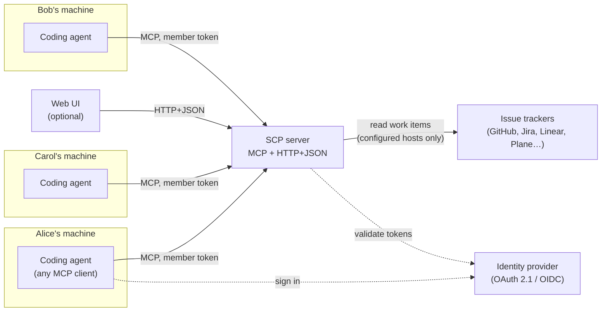

* Agents never talk to each other. They read and write one shared store, through one server.
* Code stays in version control and work stays in the tracker. The server holds short text about
  both, and references to them (§4.9).

## 2. Containers

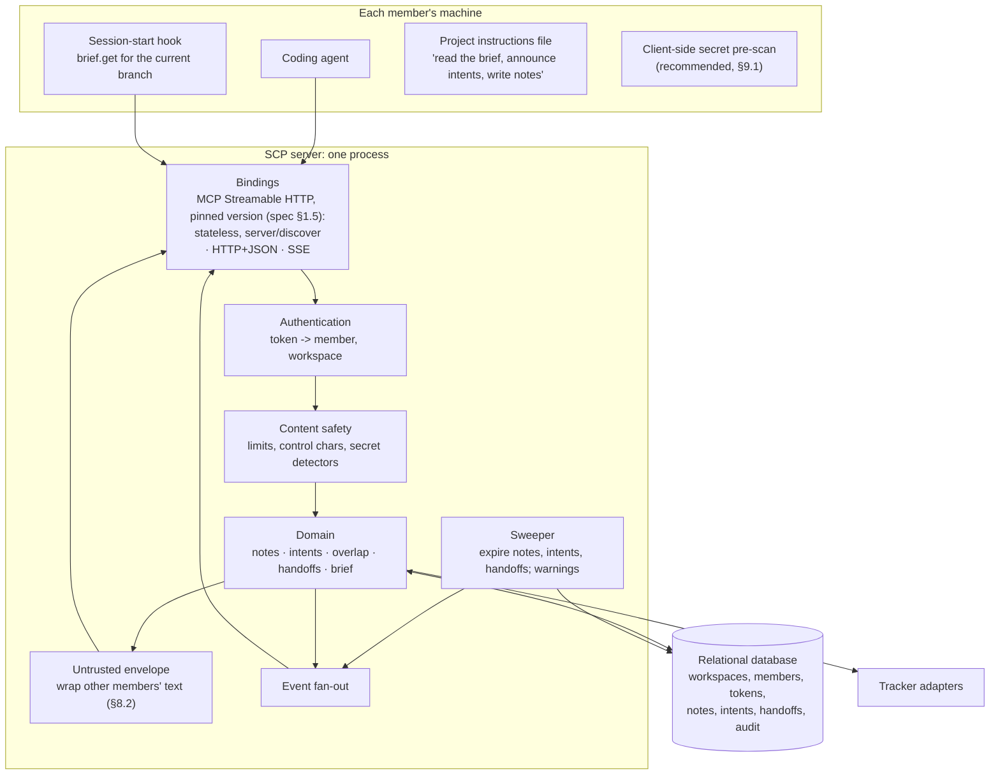

| Concern | Reference choice | Why |
| --- | --- | --- |
| Language | Go, single static binary | Easy to self-host; mature MCP SDK |
| Structure | Hexagonal: `domain/` depends on nothing; bindings, storage, trackers are adapters | The overlap rule and lifecycles are pure functions, testable without I/O |
| Storage | PostgreSQL; SQLite for single-team installs | Full-text search built in; one dependency |
| Search | Postgres `tsvector` with `websearch_to_tsquery` | Meets §5.4.3 without a vector store |
| Background work | One sweeper loop, one minute tick, `SELECT … FOR UPDATE SKIP LOCKED` | Lifecycle deadlines in §7 without a queue |
| Events | In-process fan-out; Postgres `LISTEN/NOTIFY` across replicas | No broker to run |
| Auth | Personal access tokens (HMAC-SHA-256 at rest) and OAuth 2.1 via an external IdP | §10.2 |

## 3. Storage model

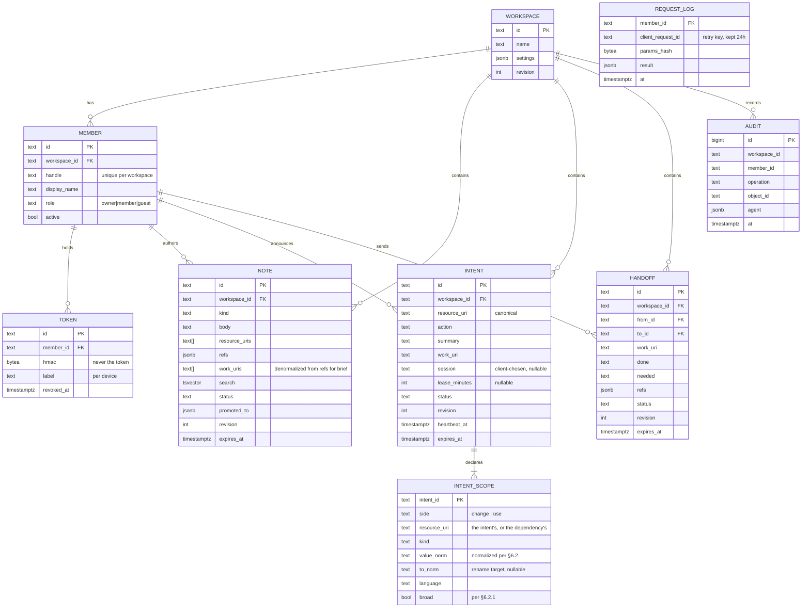

Indexes that matter:

| Query | Index |
| --- | --- |
| Active intents on a resource (overlap, brief) | `intent (workspace_id, resource_uri) WHERE status = 'active'` |
| Change and use sides on a resource | `intent_scope (resource_uri, side, kind)` |
| Scope candidates | `intent_scope (kind, value_norm text_pattern_ops)` and `(kind, to_norm)` for prefix lookups |
| Brief notes | GIN on `note.resource_uris`, GIN on `note.work_uris`, both `WHERE status = 'active'` |
| Search | GIN on `note.search` |
| Sweeper | `note (expires_at) WHERE status = 'active'`, same for intents and handoffs |

## 4. Overlap computation

The rule is §6. With a resource's active intents usually in the tens, the reference server loads
them and matches in memory; the scope index narrows candidates when a resource has many.

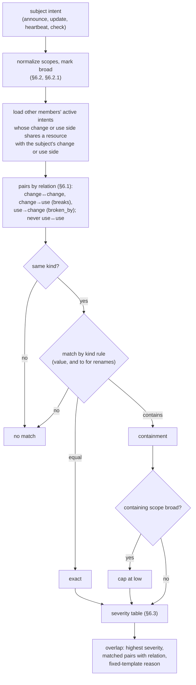

The domain function has the shape
`overlaps(subject Intent, others []Intent) []Overlap`: pure, deterministic, and table-tested
against every row of §6.2 and §6.3, every relation of §6.1, and the broad cap.

## 5. Flows

### 5.1 Session start

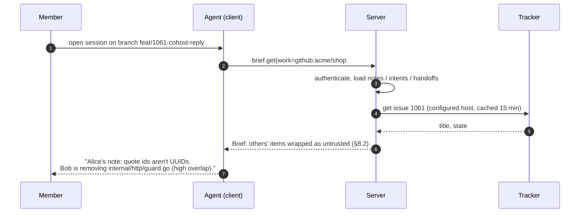

How the client finds `work` and `resources`: the hook reads the Git remote (canonicalized per
§4.7.1) and looks for a work reference in the branch name or the latest commit message, using a
pattern the team configures (e.g. `[A-Z]+-\d+`).

### 5.2 Before editing

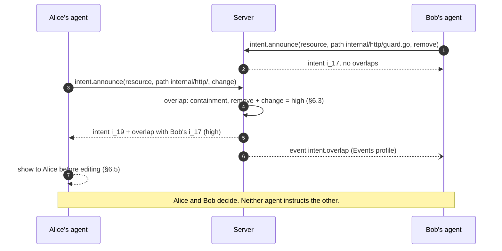

### 5.3 While working

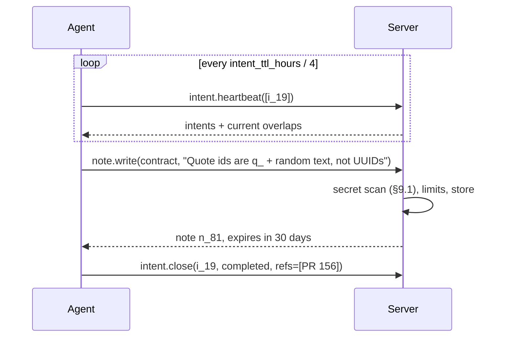

### 5.4 Handoff

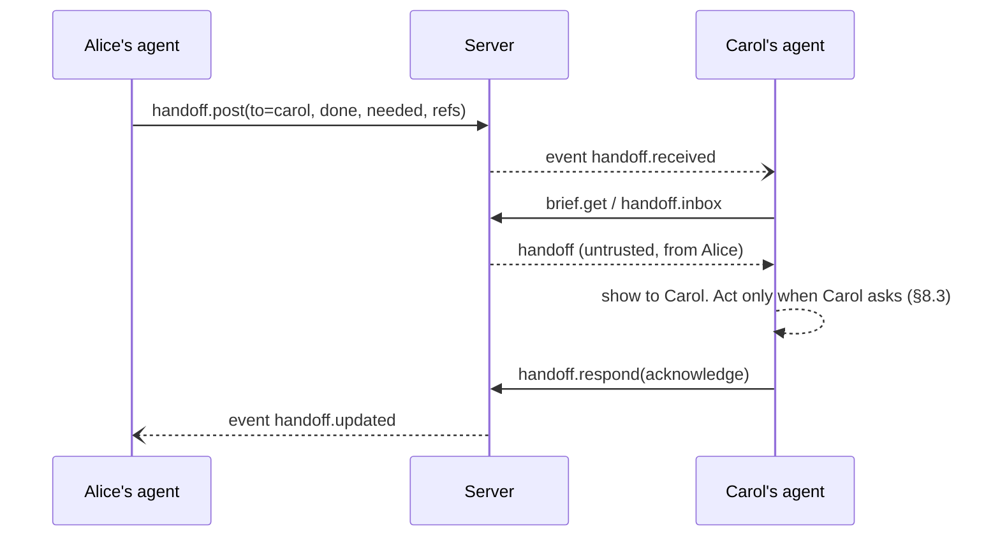

### 5.5 Memory lifecycle

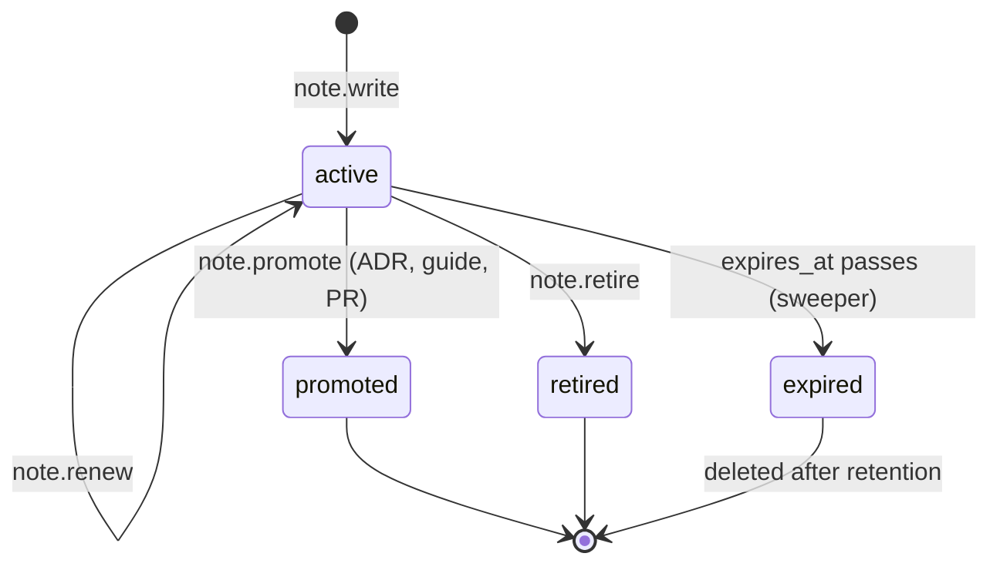

## 6. Trust boundaries

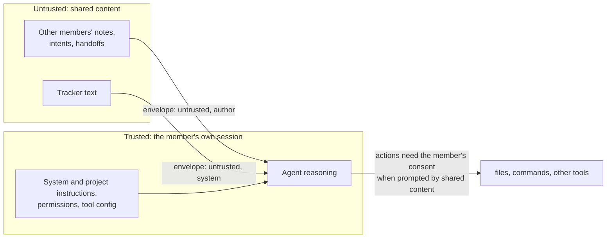

The server enforces what it can (author from credentials, wrapping, secret refusal, isolation);
the client enforces the rest (§8.3). Neither alone is enough.

## 7. Deployment

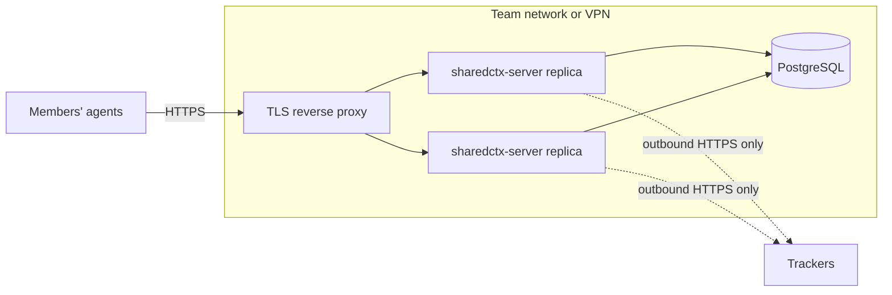

| Install | Shape |
| --- | --- |
| One small team | One binary with SQLite on a single host behind TLS |
| Organization | Two or more replicas, PostgreSQL, OIDC from the company IdP, behind VPN or an authenticating proxy |

Configuration (environment): database URL, public base URL, token HMAC key, OAuth issuer and
audience, tracker credentials per host, retention periods, rate limits.

## 8. Code layout

```text
shared-context-protocol/
  cmd/sharedctx-server/     main: config, wiring, migrations, server
  cmd/sharedctx-bridge/     stdio MCP bridge to the remote server (spec §11.1.1.2)
  internal/domain/          entities, lifecycles, overlap rule, brief assembly (stdlib only)
  internal/app/             operations (§5): authorization, revisions, audit
  internal/adapters/
    mcp/                    tools, resources, prompts, untrusted rendering (§11.1)
    httpapi/                HTTP+JSON binding and SSE (§11.2, §13)
    store/postgres/         queries, migrations
    store/sqlite/
    secrets/                detectors (Appendix B)
    trackers/{github,jira,linear,plane}/
    auth/                   tokens, OAuth resource server
  schemas/                  JSON Schemas (spec Appendix A)
  conformance/              black-box test suite against any server
  spec/  docs/
```

## 9. Testing

| Layer | What |
| --- | --- |
| Domain | Table tests for every §6.2 matching rule, rename `to` matching, every §6.1 relation, every §6.3 severity cell and the broad cap; lifecycle transitions in §7, including illegal ones; the renewal cap |
| Membership | Identity-provider group changes (§10.6): join, role change, removal denied on the next request, open intents closed |
| Content safety | Each Appendix B detector, plus placeholders that must pass |
| Bindings | The same operation through MCP and HTTP returns the same result and errors |
| Isolation | Every operation with another workspace's ids returns `NOT_FOUND` |
| Conformance | A suite runnable against any server URL, reported per profile (§16) |
